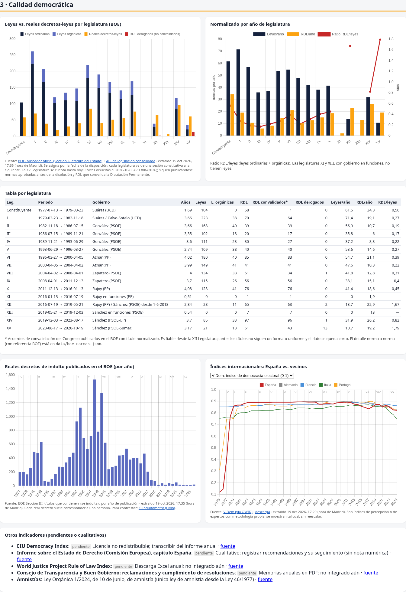

# Observatorio de calidad política · España

Web pública, objetiva y contrastable que reúne **datos brutos de fuentes oficiales e independientes** para valorar la calidad de los gobiernos y legislaturas en España (desde 1977 cuando hay datos). **No hay índice compuesto ni nota propia**: cada cifra enlaza a su fuente y lleva su fecha de extracción. Lo que no se ha podido obtener aparece como `pendiente`.

🌐 Web: https://manolenta.github.io/observatorio-politico/ (publicada con GitHub Pages; datos regenerados a diario por GitHub Actions)



## Los 4 cuadros
1. **Macro**: PIB, PIB per cápita PPA, paro, deuda, déficit, inflación y productividad (Eurostat, Banco Mundial, FMI), con España frente a la UE-27 y sus vecinos.
2. **Promesas**: cumplimiento de los pactos de 2023 (Newtral PactoCheck) y tabla de promesas clave con su evidencia (BOE).
3. **Calidad democrática**: leyes frente a reales decretos-leyes por legislatura y RDL derogados (contados en el BOE), indultos por año (BOE), V-Dem, Freedom House y Banco Mundial WGI.
4. **Corrupción**: procesos por corrupción del CGPJ (procesados, condenas, absoluciones, otras causas), TI-CPI, WGI control de la corrupción y V-Dem.

## Metodología
Ver [METODOLOGIA.md](METODOLOGIA.md): indicadores, definiciones, fuentes con URL, frecuencia, comparación entre legislaturas y riesgos de sesgo (atribución causal, duración de la legislatura, hechos frente a valoraciones).

## Fuentes
Eurostat · Banco Mundial · FMI WEO · BOE (buscador y API de datos abiertos) · CGPJ (repositorio de corrupción) · V-Dem, Freedom House y Transparency International (vía Our World in Data) · Newtral PactoCheck. Los datos sin API están en `data/manual.json`, con fuente y fecha.

## Regenerar los datos
```bash
pip install requests
bash scripts/update_all.sh          # descarga todo y genera site/data.js
cd site && python3 -m http.server 8765
```
GitHub Actions lo hace a diario a las 07:17 hora de Madrid (`timezone: Europe/Madrid`, ajustado al cambio de hora) (`.github/workflows/actualizar.yml`) y publica `site/` en GitHub Pages. Detalle de cada script: [scripts/README.md](scripts/README.md).

## Colaborar
Lee [CONTRIBUTING.md](CONTRIBUTING.md). Regla de oro: **toda cifra debe llevar una fuente verificable**.

## Licencia
El código está bajo MIT. Los datos pertenecen a sus fuentes y se reutilizan con atribución. Ver [LICENSE](LICENSE).
